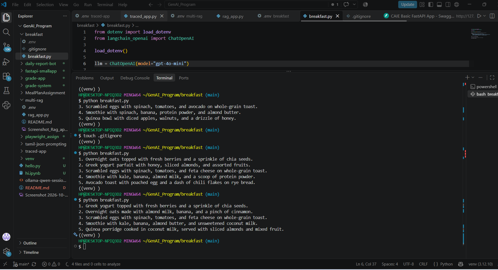

# Breakfast Ideas with an AI Model

## What this project is

This small Python script asks the OpenAI `gpt-4o-mini` model for exactly five healthy breakfast ideas. It prints the model's answer as a numbered list.

The script is [`breakfast.py`](./breakfast.py). It uses LangChain to send the prompt to the model and `python-dotenv` to read settings from a local `.env` file.

## Set up

Use Python 3.10 or newer. Open PowerShell in this folder and install the required packages:

```powershell
python -m pip install python-dotenv langchain-openai
```

Add your OpenAI API key to the local `.env` file:

```dotenv
OPENAI_API_KEY=your_openai_api_key
```

Replace the example value with your own key. Do not share or commit the real `.env` file. The project `.gitignore` is intended to keep it out of Git.

## Run

```powershell
python .\breakfast.py
```

The script makes an API request, so a valid key and internet connection are needed. API usage may incur charges.

## Example run

The screenshot shows the script being run several times in the terminal:



## Task completed

The script sends a clear prompt to an AI model and requests exactly five breakfast ideas, formatted as a numbered list with one idea per line and no extra introduction or conclusion.

## Beginner task question

**Can you write a Python script that asks an AI model for exactly five breakfast ideas and prints only a numbered list, with no extra text?**

Try changing the prompt to request a different meal or dietary preference. Run it again and check whether the model follows the requested number and format.

## What still needs to be done

- Run the script with a valid API key and confirm it prints five numbered ideas.
- Check whether the answer follows the one-line-per-idea format; AI responses may not always follow instructions perfectly.
- Add a dependency file such as `requirements.txt` if the project will be shared or installed on another computer.
- Avoid entering private or sensitive information in prompts.
