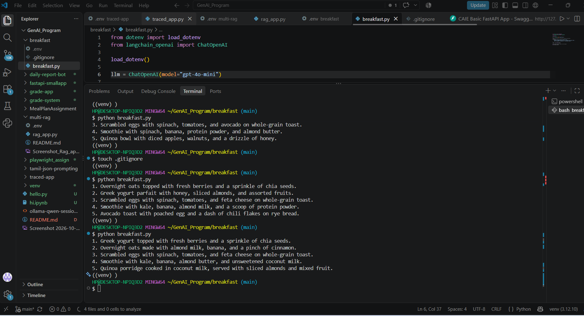

# Breakfast Ideas: Prompt Formatting with LangChain

> A first LangChain script that shows how precise instructions control LLM output format.

   

## Overview

A short starter project: one prompt asks `gpt-4o-mini` for **exactly 5** healthy breakfast ideas, numbered, one line each, with no extra text. It demonstrates how clear formatting constraints make LLM output predictable enough to use in code.

## Demo



## Tech stack

| Layer | Technology |
|---|---|
| Orchestration | LangChain |
| Model | OpenAI `gpt-4o-mini` |

## Project structure

```text
.
├── breakfast.py
├── requirements.txt
└── .env.example
```

## Getting started

**Prerequisites:** Python 3.10+

```bash
git clone https://github.com/prasanth-sundararajan/breakfast.git
cd breakfast
python -m venv .venv
# Windows: .venv\Scripts\activate    macOS/Linux: source .venv/bin/activate
pip install -r requirements.txt
```

Copy `.env.example` to `.env` and add your keys:

```bash
cp .env.example .env
```

## Usage

```bash
python breakfast.py
```

## Configuration

| Variable | Required | Description |
|---|---|---|
| `OPENAI_API_KEY` | Yes | OpenAI API key used for chat and embeddings |

## License

Released under the [MIT License](LICENSE).

## Author

**Prasanth Sundararajan**, Senior SRE and AI Engineer  
[LinkedIn](https://www.linkedin.com/in/prasanth-s-a093a7109/) · [GitHub](https://github.com/prasanth-sundararajan)
